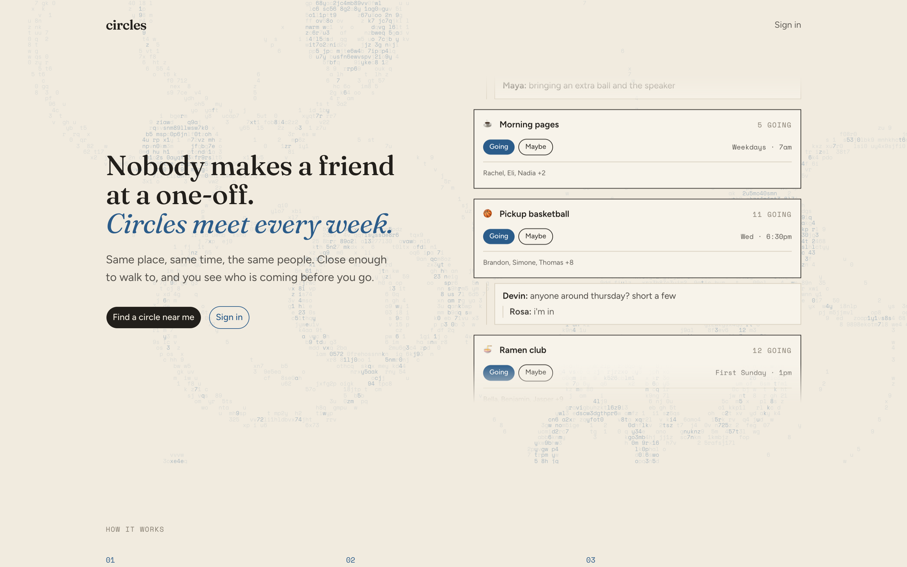
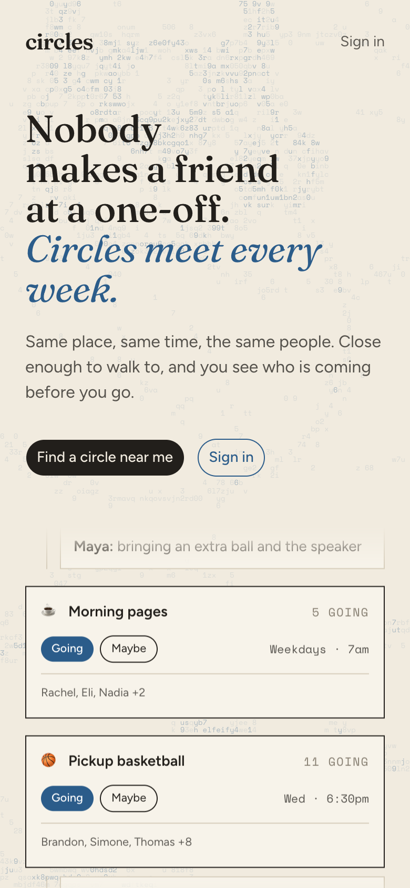

# Circles

[](https://github.com/bbookkss/circles/actions/workflows/ci.yml)

**Nobody makes a friend at a one-off. Circles meet every week.**

Circles is a web app for recurring, in-person groups: the same place, the same
time, the same people. Each circle has a spot on the map and a day it meets.
Members say whether they are coming, see who else is, and get a reminder
before it starts. Live at [hicircles.com](https://hicircles.com).

<p>
  
  
</p>

## How it works

1. **Find one near you.** Browse circles on a map and pick one close enough
   to walk to.
2. **Say if you are coming.** Check in the day before and see who else is in,
   so you are never the only one who showed.
3. **Come back.** The circle meets on its schedule, weekly, biweekly or
   monthly, and members get an email reminder 24 hours and 3 hours before.

## Design decisions

**Non-members never receive a circle's exact location.** A circle publishes
when and where a group of people will be, so the precise point and the venue
name are for members only. This is enforced in Postgres, not the web server.
SELECT on the exact columns is withheld from every client role, so no query
can read them or even filter on them. Members get them through a
`security definer` function that checks membership. Everyone else sees an
area about 1.1 km in radius. A trigger computes its centre from the point
plus a per-circle offset that is random, stored, and never readable. It is
random so it cannot be recomputed from public data, and stored so reloading
and averaging recovers nothing.

**Block and report are enforced by the same policies that gate everything
else.** A block hides the conversation, posts, comments and notifications in
both directions and cuts follows, through one helper that only ever answers
about the caller. Reports go through a function that checks the reporter can
see what they are reporting and snapshots it, so the evidence survives the
author deleting it.

**Row-level security on every table, with column-level grants.** Every table
in the `public` schema has RLS enabled, and the app queries Postgres with
the visitor's own session. The service-role key is confined to a few
server-only paths, such as the reminder cron and unsubscribe links. Where a
policy is too coarse, grants are made per column: anonymous visitors can read
a profile's display fields but not the rest of the row, and signed-in users
can update only the profile columns listed in the grant.

**Migrations are dated SQL files, and risky ones are rehearsed.** Every
schema change is a checked-in file under `supabase/`, named
`<topic>-<date>.sql`. The riskier ones ship with a `.rehearsal.sql` that
builds synthetic data inside a transaction, asserts the expected behaviour
with OK/FAILED output, and rolls back. The rehearsal for the mutual-members
query builds a "leaker": someone who shares a circle with both people but
only through a private circle the viewer cannot see. The test proves they are
not returned, so a "you both know Sam" feature cannot expose a private
roster.

**Each circle keeps its own timezone, resolved from its coordinates.** When a
circle is created or moved, the server derives its IANA zone from latitude
and longitude with `tz-lookup`. Schedules and "today" are computed in that
zone, so a meet reads correctly no matter where the server or the viewer is.

**Unsubscribes are keyed to the email address, not the account.**
`email_suppressions` stores the address itself, so the one-click unsubscribe
link works without signing in, and the suppression survives the account
being deleted and recreated with the same address.

**Email goes out from a sending subdomain.** Reminders are sent through Resend
from `send.hicircles.com`, which carries its own SPF and DKIM, so sending
reputation is isolated from the root domain. Replies go to a real inbox on
the root domain.

## Stack

- Next.js 16 (App Router, server actions), React 19, TypeScript
- Supabase: Postgres, Auth, row-level security, `pg_cron` for scheduled reminders
- Mapbox GL via `react-map-gl`, Mapbox Search Box for place lookup
- Tailwind CSS 4
- Resend for transactional email
- Vercel for hosting

## Running locally

Requires Node 26 (see `.nvmrc`) and a Supabase project.

```bash
npm install
cp .env.example .env.local   # then fill in the values
npm run dev
```

`.env.example` lists every variable the code reads, with a line on each. The
database schema is in `supabase/schema.sql`, a dump of the live state.

## Tests

```bash
npm test
```

Unit tests use Node's built-in test runner and cover the parts with real
logic: schedule and timezone maths, and map view resolution. Database
behaviour, including location privacy and blocking, is covered by the
`.rehearsal.sql` files.

## Project notes

- [docs/PRODUCTION.md](docs/PRODUCTION.md): what still needs doing before
  launch, what has been verified, and what has never been tested.
- [docs/ROADMAP.md](docs/ROADMAP.md): features we want to build, specced
  enough to start cold.
- [docs/HANDOFF.md](docs/HANDOFF.md): the historical record of what changed
  and why, including the traps that cost real time.
- [docs/SMS-LOOP.md](docs/SMS-LOOP.md): the spec for SMS check-ins and
  reminders.
- [docs/A2P-REGISTRATION.md](docs/A2P-REGISTRATION.md): US carrier
  registration for SMS, with the submission copy written out.
