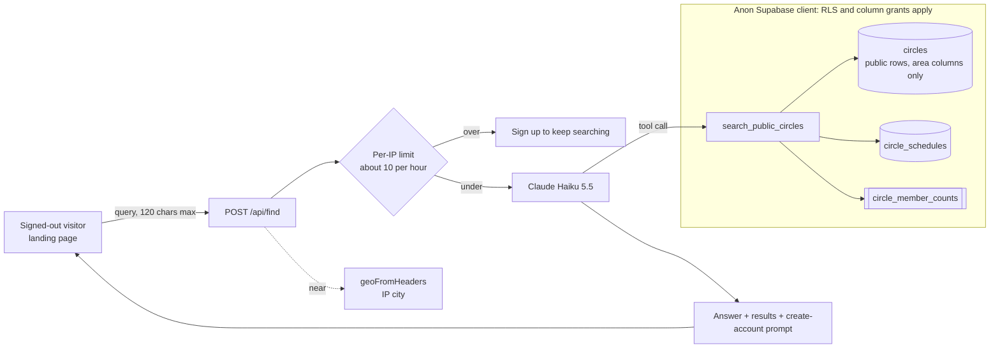

# Public search

The landing page asks "What do you want to find?". A signed-out visitor types an
activity. The agent searches public circles near them, describes what it found,
and asks them to make an account to see where the circles meet and who's going.

- **Route:** `POST /api/find` (new)
- **Model:** Claude Haiku 5.5 (`claude-haiku-5-5`). It's cheap enough for
  anonymous traffic, and the job is narrow.
- **Runs as:** the anon Supabase client. RLS limits it to public circles,
  and column grants limit it to area-level location.
- **Mockup:** `mockups/index.html` (git-excluded)

## Tools

| Tool | What it does | Reads / writes | Status |
| --- | --- | --- | --- |
| `search_public_circles(query, near?)` | Keyword match on name, description and category. Returns name, neighbourhood, days, member count and area point, sorted by distance from `near`. Never the venue or exact point. | Reads `circles` (public rows; `area_latitude`, `area_longitude`, `neighborhood`, `city`, `category`, `name`, `description`, `kind`), `circle_schedules`, `circle_member_counts` | New |

`near` isn't something the model chooses. The route fills it from
`geoFromHeaders` (exists, `src/lib/mapView.ts`). The visitor never typed a
location, and the model shouldn't guess one.

## Guardrails

- **The rate limit runs before the model.** It's per IP only (decided
  2026-11-18), so a visitor over the limit costs nothing.
- **Small inputs, small budgets.** The input is capped at 120 characters.
  The model gets a few tool calls at most, and a low `max_tokens`.
- **Area only, enforced by the database.** After
  `location-lockdown-2026-11-18.sql`, anon cannot select `latitude`,
  `longitude` or `location` at all. The tool couldn't return a venue even
  if the prompt asked it to.
- **Every answer ends by asking for an account.** That's the agent's job:
  enough to show the circles are real, and the rest after sign-up.
- **No memory.** Each search stands alone, and nothing is stored about the
  visitor beyond the rate-limit counter.

## Open questions

- The rate-limit number, and where the counter lives: a Supabase table or
  Vercel KV.
- Whether a search with no results should still use the model, or return a
  fixed "start the first one" reply for free.
- Whether to log queries, without IPs, to learn what people want that
  doesn't exist yet. That's useful for seeding circles.
